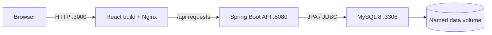
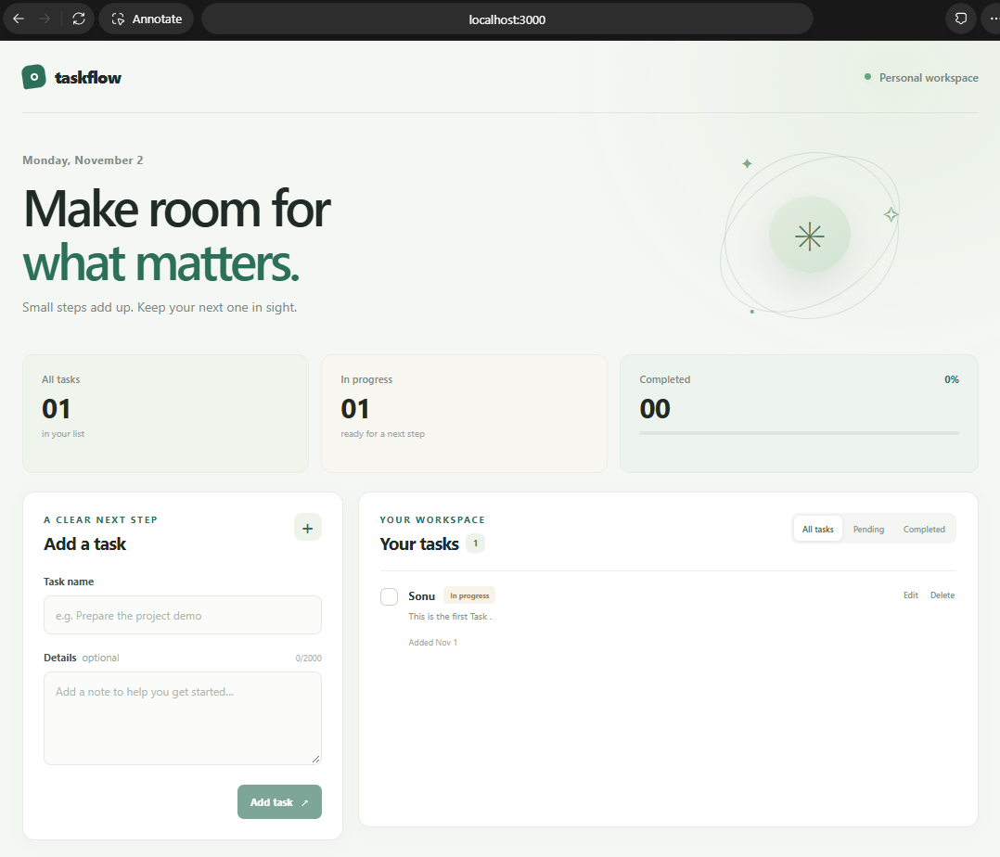

# Docker Task Manager

A small, full-stack task manager that demonstrates how to package a React frontend, Spring Boot REST API, and MySQL database as separate services with Docker Compose. Tasks are stored in MySQL and remain available after containers are recreated because the database uses a named volume.

## What it can do

- Create, view, edit, and delete tasks.
- Mark a task completed or pending.
- Validate task names and descriptions in the API.
- Persist task data in MySQL.
- Build the frontend and backend as separate, multi-stage Docker images.
- Start the services in dependency order using database and API health checks.

## Architecture



The browser connects to the frontend. Nginx serves the compiled React files and proxies `/api` requests to Spring Boot over the private Compose network. Spring Boot uses MySQL by the Compose service name `mysql`. The MySQL port is not published to the host; the backend is published on loopback for local API checks.

## Technology stack

| Area | Technology |
| --- | --- |
| Frontend | React 19, Vite 8, JavaScript, CSS |
| API | Java 17, Spring Boot 3.5, Spring Web, Spring Data JPA, Validation |
| Schema migrations | Flyway |
| Database | MySQL 8.4 |
| Containers | Docker, Docker Compose v2 |
| Source control | Git / GitHub-ready project layout |

## Project structure

```text
docker-task-manager/
├── frontend/
│   ├── src/
│   │   ├── api/tasks.js               # HTTP calls to the REST API
│   │   ├── components/                # Task form, list, and task row
│   │   ├── App.jsx                    # Page state and CRUD actions
│   │   ├── main.jsx                   # React entry point
│   │   └── styles.css                 # Responsive interface styles
│   ├── public/                        # Static assets copied as-is by Vite
│   ├── Dockerfile                     # Vite build stage and Nginx runtime
│   ├── nginx.conf                     # Static hosting and /api reverse proxy
│   ├── package.json                   # Frontend dependencies and commands
│   └── vite.config.js                 # Vite dev server API proxy
├── backend/
│   ├── src/main/java/...              # Spring Boot API, service, entity, and DTOs
│   ├── src/main/resources/
│   │   ├── application.yml            # Runtime database and JPA configuration
│   │   └── db/migration/              # Versioned Flyway SQL migrations
│   ├── src/test/                      # REST integration tests using H2
│   ├── Dockerfile                     # Maven/JDK build and Java runtime stages
│   └── pom.xml                        # Backend dependencies and build setup
├── .github/workflows/ci.yml           # GitHub Actions test and build checks
├── docs/screenshots/                  # Place project screenshots here
├── docker-compose.yml                 # Frontend, backend, database, network, volume
├── .env.example                       # Safe template for local environment values
├── .gitignore                         # Excludes secrets and build output
└── README.md
```

### Important files

- `backend/src/main/java/com/example/taskmanager/controller/TaskController.java` defines the task API routes.
- `backend/src/main/java/com/example/taskmanager/service/TaskService.java` holds task operations and mapping between API data and database entities.
- `backend/src/main/java/com/example/taskmanager/entity/Task.java` is the JPA representation of a task row.
- `backend/src/main/resources/db/migration/V1__create_tasks.sql` creates the MySQL table. Flyway applies it when the backend starts.
- `frontend/src/api/tasks.js` centralizes frontend requests and API errors.
- `frontend/Dockerfile` uses Node to build static assets, then copies only those assets into Nginx.
- `backend/Dockerfile` builds and tests the executable JAR with Maven, then copies it into a smaller Java runtime image.
- `docker-compose.yml` wires together service discovery, startup health checks, host ports, the private network, and persistent storage.
- `.env` contains local database passwords. It is ignored by Git; never commit real passwords.

## Prerequisites

- Docker Desktop or Docker Engine with the Compose v2 plugin.
- Git, if you are cloning the repository.
- An available host port for the frontend (default `3000`) and API (default `8081`).

Java, Node.js, Maven, and MySQL do **not** need to be installed on the computer that runs the containerized application. They are supplied by the image build stages or the MySQL image.

## Run the application

1. Clone the GitHub repository (replace the sample account with the repository owner):

   ```bash
   git clone https://github.com/<your-username>/docker-task-manager.git
   cd docker-task-manager
   ```

2. Create your local environment file and replace both password placeholders with strong, different values:

   **macOS / Linux / Git Bash**

   ```bash
   cp .env.example .env
   ```

   **Windows PowerShell**

   ```powershell
   Copy-Item .env.example .env
   ```

3. Build the frontend and backend images, then start all services:

   ```bash
   docker compose up --build
   ```

   Compose builds the application images, waits for MySQL to become healthy before starting the API, then waits for the API health check before starting the frontend.

4. Open [http://localhost:3000](http://localhost:3000). The backend health endpoint is available at [http://localhost:8081/api/health](http://localhost:8081/api/health).

For a background run, use `docker compose up --build -d`.

## Docker image commands

Build each image separately from the project root:

```bash
docker build -t task-manager-backend:local ./backend
docker build -t task-manager-frontend:local ./frontend
```

Each Dockerfile has separate build and runtime stages. The backend's Maven build runs the API integration tests before creating the JAR. The frontend build compiles React with Vite, then serves the output from Nginx.

## Docker Compose commands

Run these from the project root:

```bash
docker compose up --build       # Build and start in the foreground
docker compose up --build -d    # Build and start in the background
docker compose ps               # Show service state and health
docker compose logs -f          # Follow all service logs
docker compose logs -f backend  # Follow one service
docker compose restart backend  # Restart one service
docker compose down             # Stop and remove containers and network
docker compose down -v          # Also delete persistent database data
```

The named `docker-task-manager-mysql-data` volume survives `docker compose down`. Use `docker compose down -v` only when you intentionally want to erase all task data.

## Container and API management

The backend is published on `127.0.0.1:8081` for local checks. For example:

```bash
curl http://localhost:8081/api/tasks
curl http://localhost:8081/api/health
```

The frontend is published on port `3000`. MySQL stays private to the Compose network on port `3306`; other containers connect using the hostname `mysql` rather than `localhost`.

To change host ports, edit `FRONTEND_PORT` or `BACKEND_PORT` in `.env`, then recreate the services with `docker compose up -d`.

## API routes

| Method | Route | Purpose |
| --- | --- | --- |
| `GET` | `/api/tasks` | List tasks, newest first |
| `GET` | `/api/tasks/{id}` | Get one task |
| `POST` | `/api/tasks` | Create a task (`title`, optional `description`) |
| `PUT` | `/api/tasks/{id}` | Update task details |
| `PATCH` | `/api/tasks/{id}/status` | Set `completed` to `true` or `false` |
| `DELETE` | `/api/tasks/{id}` | Delete a task |
| `GET` | `/api/health` | Check API and database connectivity |

## Tests and development

The backend integration tests exercise create, list, update, status changes, delete, and request validation against an in-memory H2 test database. They run when building the backend image and do not require a local MySQL server.

The GitHub Actions workflow at `.github/workflows/ci.yml` runs the backend checks and frontend production build for pushes and pull requests.

### Windows test and run instructions

Open PowerShell and run these commands from the project folder:

```powershell
cd "C:\Users\singh\Downloads\docker-task-manager\docker-task-manager"
docker --version
docker compose version
docker compose build backend
docker compose build frontend
docker compose up -d
docker compose ps
Invoke-WebRequest http://localhost:8081/api/health
Invoke-WebRequest http://localhost:8081/api/tasks
```

Then open [http://localhost:3000](http://localhost:3000) in a browser. To inspect errors, run:

```powershell
docker compose logs backend
docker compose logs frontend
docker compose logs mysql
```

The first Docker build may take several minutes. If Docker reports a download error containing `EOF`, retry:

```powershell
docker compose build backend
docker compose up -d
```

For local development only, install Java 17, Maven, and Node.js 22.12 or newer. Then run the backend with the test profile or provide the three `SPRING_DATASOURCE_*` environment variables, and start the frontend with `npm install && npm run dev`. The Vite proxy defaults to `http://localhost:8080`; override it with `VITE_API_PROXY_TARGET` if your local backend uses another port. The normal Docker workflow does not need these local tools.

## Troubleshooting

### Compose says a password or database setting is missing

Make sure the project has a `.env` file in the same directory as `docker-compose.yml`. Start from `.env.example` and replace the password placeholders.

### The frontend or backend port is already in use

Change `FRONTEND_PORT` or `BACKEND_PORT` in `.env`, then run `docker compose up --build -d` again. For example, set `FRONTEND_PORT=3001` and open `http://localhost:3001`.

### A service remains unhealthy

Inspect startup logs and health state:

```bash
docker compose ps
docker compose logs mysql
docker compose logs backend
docker compose logs frontend
```

MySQL may need extra time on its first start. The API starts only after the database health check succeeds, and the frontend starts only after the API can query the database.

### The frontend shows an API connection error

Check that `backend` is healthy and inspect its logs. The frontend container must reach the backend as `backend:8080` over the Compose network; `localhost` inside a container refers to that same container.

### I changed `.env`, but MySQL still uses the old password

MySQL applies its initialization variables only when the data directory is first created. Changing passwords in `.env` does not rewrite an existing database user's password. If this is a disposable development database, `docker compose down -v` will remove it and the next startup will initialize with the new values. This also deletes all saved tasks, so export anything you need first.

## Screenshots

After starting the app, capture the dashboard and save the image as `docs/screenshots/taskflow-dashboard.png`. Add it here with:

```markdown

```

Current dashboard:


The repository does not include a fabricated screenshot; use an image captured from the running application.

## Portability notes

The same Compose file and `.env` settings can be used on another computer with Docker Compose v2. The API connects to the database through the Compose service name, the frontend uses Nginx as a reverse proxy, and the named MySQL volume stores application data across container replacements. Only the initial image build needs to download its base images and package dependencies.
